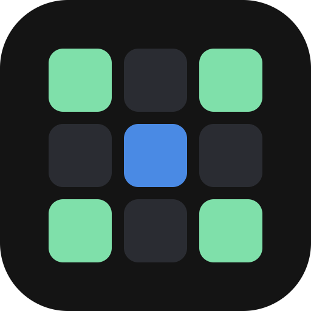
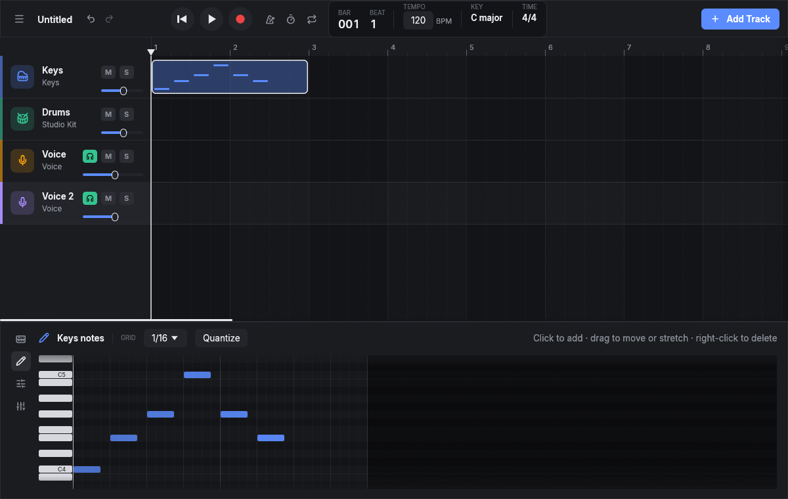
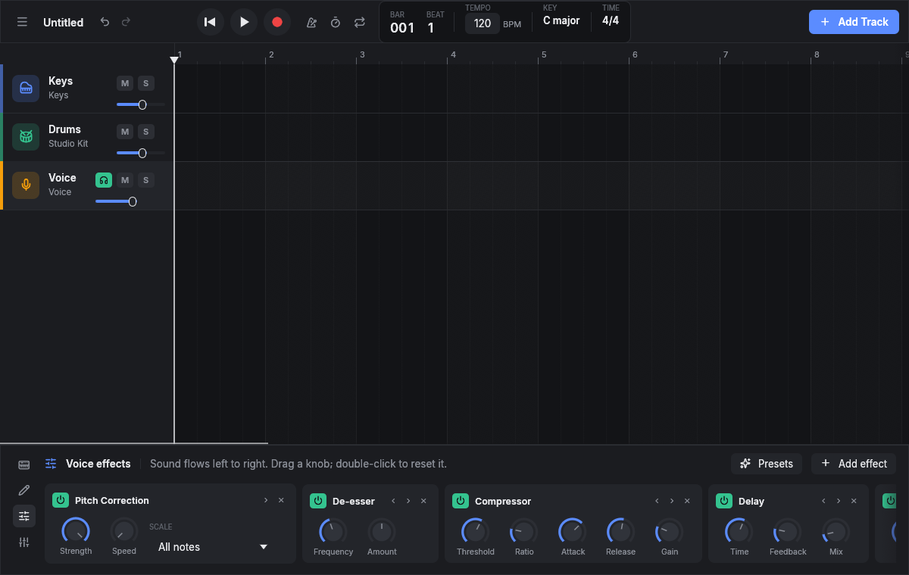
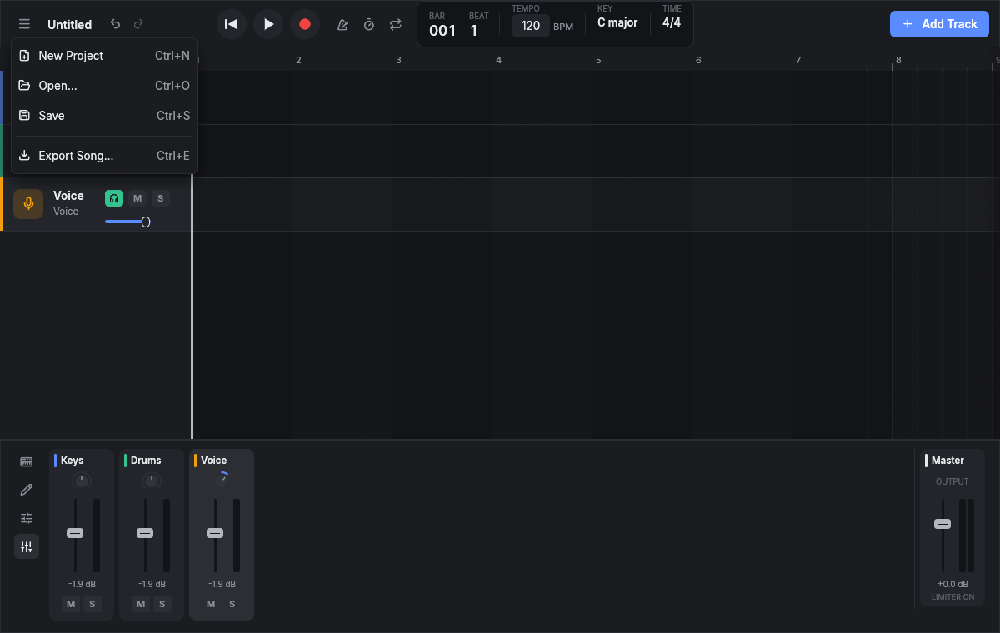
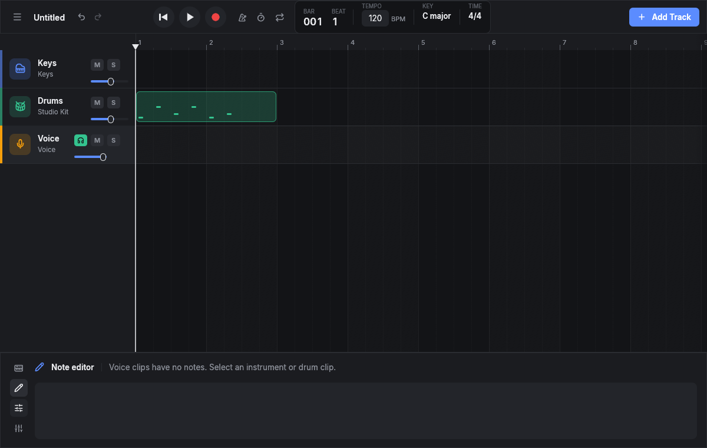

<div align="center">



# Oxbeat

**Open it and make music.**
A free, friendly music studio for Windows, macOS and Linux.

[](https://github.com/matthias-peterlini/Oxbeat/actions/workflows/ci.yml)
[](https://github.com/matthias-peterlini/Oxbeat/releases)
[](LICENSE)


[Website](https://oxbeat.it) ·
[Download](https://github.com/matthias-peterlini/Oxbeat/releases) ·
[Sound packs](https://github.com/matthias-peterlini/Oxbeat-beats) ·
[Build from source](#build-from-source)

</div>



Oxbeat has the "plug in a keyboard and play" feel of GarageBand, and it runs everywhere.
There is no account, no subscription and no setup screen: the first thing you see is a
track that already makes sound.

## What you can do

| | |
|---|---|
| **Play** | Plug in a MIDI keyboard and it just works, or play from the computer keyboard or the on-screen keys and drum pads. |
| **Sounds** | Built-in synths and drum kits, plus a sound browser that loads SoundFont (SF2), SFZ and plain audio files. |
| **Sound packs** | Download free pianos, drums, saxophones, flutes and a full General MIDI set from inside the app. |
| **Record** | Record what you play as notes, or your voice or an instrument through a microphone, with a level meter and monitoring. |
| **Edit** | Move, stretch, split and duplicate clips. Draw and fix notes in a piano roll, or program beats on a drum grid. Quantize in one click. |
| **Effects** | Reverb, delay, EQ, compressor, distortion, chorus, noise gate, de-esser and pitch correction, with one-click vocal presets. |
| **Mix** | A mixer with faders, pan and meters for every track, and a master limiter so a loud song never distorts. |
| **Stay in time** | Metronome, count-in before recording, and a loop range for practising a section. |
| **Share** | Export your song as MP3 or WAV. |
| **Relax** | Undo and redo everything. |

<table>
<tr>
<td><br><sub>Effects: sound flows left to right</sub></td>
<td><br><sub>Mixer and master</sub></td>
</tr>
<tr>
<td><br><sub>Drum grid</sub></td>
<td><br><sub>Piano roll</sub></td>
</tr>
</table>

## Download

Get the installer for your system from the
[Releases page](https://github.com/matthias-peterlini/Oxbeat/releases):

| System | File |
|---|---|
| Windows 10 / 11 | the `.exe` installer |
| macOS (Apple Silicon) | the `.dmg` ending in `aarch64-apple-darwin` |
| macOS (Intel) | the `.dmg` ending in `x86_64-apple-darwin` |
| Linux | the `.AppImage` (any distribution) or the `.deb` (Debian, Ubuntu) |

The builds are not code-signed yet, so Windows SmartScreen and macOS Gatekeeper will ask
before the first launch ("More info → Run anyway" on Windows; right-click → Open on macOS).

## Shortcuts

| Key | Does |
|---|---|
| `Space` | Play / stop |
| `R` | Record on the selected track |
| `Enter` | Back to the start |
| `A` – `K`, `W` `E` `T` `Y` `U` | Play notes (or drum pads) |
| `Z` / `X` | Octave down / up |
| `Ctrl+Z` / `Ctrl+Shift+Z` | Undo / redo |
| `Ctrl+D` | Duplicate the selected clip |
| `Ctrl+T` | Split the selected clip at the playhead |
| `Delete` | Delete the selected note or clip |
| `Ctrl+S` / `Ctrl+O` / `Ctrl+N` | Save / open / new project |
| `Ctrl+E` | Export the song |

On macOS use `Cmd` where this says `Ctrl`. Hold `Shift` while dragging a clip for finer
steps; double-click a clip to edit its notes, or an empty lane to start a new one.

## Sound packs

Packs live in [Oxbeat-beats](https://github.com/matthias-peterlini/Oxbeat-beats) and are
installed from **Add Track → Store**. Every pack is free to use in your own music and ships
with its licence. You can also point the browser at any `.sf2`, `.sfz` or audio file on your
disk.

## Build from source

You need [Rust](https://rustup.rs) (stable).

Linux also needs a few system libraries:

```bash
sudo apt-get install -y libasound2-dev libudev-dev libxkbcommon-dev libgtk-3-dev
```

Then:

```bash
cargo run --release
```

Run the tests with `cargo test`.

## How it is built

Oxbeat is written in Rust. The interface is [egui](https://github.com/emilk/egui); audio and
MIDI go through [cpal](https://github.com/RustAudio/cpal) and
[midir](https://github.com/Boddlnagg/midir). The audio engine runs on its own real-time thread
and never allocates, locks or touches the disk there; everything heavy is prepared elsewhere
and handed over through lock-free queues. A project is a folder (`MySong.oxbeat`) holding a
readable `project.json` and your recordings.

## Website

The site at [oxbeat.it](https://oxbeat.it) lives in [`site/`](site): plain HTML and CSS served
by a Cloudflare Worker. Preview it with `npx wrangler dev --config site/wrangler.jsonc` and
publish it with `npx wrangler deploy` from the `site` folder.

## Contributing

Bug reports, ideas and pull requests are welcome. Please run `cargo fmt`, `cargo clippy
--all-targets -- -D warnings` and `cargo test` before opening a pull request.

## License

Oxbeat is free software under the [GNU General Public License v3.0 or later](LICENSE).
Bundled fonts: Inter (SIL Open Font License) and Lucide icons (ISC). MP3 export uses
[shine-rs](https://github.com/wshon/shine-rs) (LGPL).
